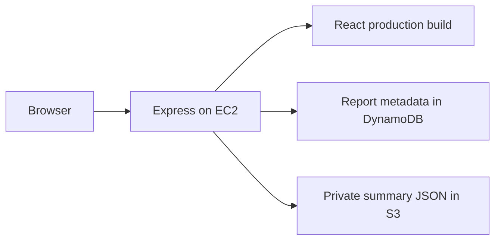

# Parliament in Five — EC2 application

A public reader for Singapore Hansard summaries. React provides a report archive
and a five-minute reader. Express serves the production React build and retrieves
saved metadata from DynamoDB and saved summary text from private S3. No AI model
is called when a reader visits the website.

## Architecture and assumptions



- One archive row and one summary per Hansard report; no weekly aggregation.
- Public access without accounts. The table contains only approved public reports.
- `HansardReportSummaryId` is the unique string DynamoDB partition key, with no sort key.
- DynamoDB attributes: `DateOfRelease` (ISO `YYYY-MM-DD`), `ActualReportLink`,
  `HansardReportSummaryId`, and `S3BucketLink`.
- Release dates are supplied by the publisher, not inferred from sitting dates.
- S3 objects contain **only** nonempty string `title` and `body` fields.
  The body is plain text with paragraph breaks, not HTML or Markdown.
- The ingestion/summarisation publisher is separate. This application does not
  create resources, generate content, or implement an editorial approval workflow.
- Region defaults to Singapore (`ap-southeast-1`). S3 remains private.

Stack: Node.js 24, TypeScript, React, Vite, React Router, Express 5, AWS SDK v3,
Zod validation, and CSS. Each project has its own package manifest and lockfile.

## Implementation plan

1. Create these architecture and project READMEs, then initialise both npm projects.
2. Implement validated configuration, DynamoDB list/detail retrieval, S3 reads,
   JSON API errors, and production static serving in the backend.
3. Implement the responsive introduction, paginated archive, title/body reader,
   loading/empty/error states, and route handling in the frontend.
4. Verify types, lint, production builds, and manual API/browser smoke scenarios.
   No automated test cases are included, as requested.
5. Document EC2 installation, permissions, service management, and verification.

## Local setup

### Preview with mock data (no AWS required)

From the **repository root**, run:

```sh
npm --prefix ec2-instance/frontend ci
npm --prefix ec2-instance/backend ci
npm run start:local
```

Open **http://127.0.0.1:3000**. The command builds React, then starts Express
serving both that build and the two POST APIs with 25 fictional reports. This
lets you try both archive pages, reader navigation, and direct-link refresh.
No AWS credentials, DynamoDB table, S3 bucket, or `.env` files are required.
Sample summaries are clearly marked as fictional. Official-report buttons point
to the Parliament reports portal rather than pretending to identify real reports.

Stop with Ctrl+C. `PORT` in backend `.env` (or the shell) changes the default port;
the preview always binds to loopback. Keep frontend `VITE_API_BASE_URL=/api` so
it calls the same local Express server. Re-run the command after frontend edits
to rebuild. This command does not start Vite or open a browser automatically.

The mock repository is selected only by `start:local`. The normal backend
`npm start` and `npm run dev` continue to use DynamoDB/S3 and never fall back to
mock data. From the backend folder, `npm run start:local` starts the preview using
the existing frontend build; use the repository-root command to rebuild first.

### Develop with live AWS data

Install Node.js 24. In each project directory run `npm ci`, then copy
`.env.example` to `.env`. The backend requires real table/bucket names and AWS
credentials, from a local AWS profile or the standard AWS credential chain.
No AWS keys belong in the frontend or in committed files.

```powershell
# Terminal 1, from ec2-instance/backend
Copy-Item .env.example .env
npm ci
npm run dev

# Terminal 2, from ec2-instance/frontend
Copy-Item .env.example .env
npm ci
npm run dev
```

Edit backend `.env` before starting. Visit `http://localhost:5173`. Vite proxies
`/api` to Express at `http://127.0.0.1:3000`. For a production-like local run,
build both projects and start the backend (see below), then visit port 3000.

## API contracts

| Endpoint            | Request                            | Success                                          |
| ------------------- | ---------------------------------- | ------------------------------------------------ |
| `POST /api/summary` | No body, or `{}`                   | `200`, array of metadata objects                 |
| `POST /api/detail`  | `{"hansardSummaryId":"report-id"}` | `200`, `{"title":"...","body":"..."}`            |
| `GET /api/health`   | None                               | `200`, `{"status":"ok"}` (process liveness only) |

List entries contain exactly `DateOfRelease`, `ActualReportLink`, and
`HansardReportSummaryId`. S3 locations are never sent to the browser. Errors use
`{"error":{"code":"...","message":"..."}}`: 400 for invalid requests, 404 for
unknown IDs/routes, and 500 for internal/AWS/stored-content failures. All failed
frontend requests show an error state. See the backend README for examples.

## EC2 deployment (Ubuntu)

For the complete step-by-step walkthrough, including AWS resource creation,
configuration values, first-report upload, and persistent startup, see
[SETUP.md](SETUP.md).

Provision EC2 in Singapore with Node.js 24 and a read-only instance role.
Clone this repository to `/opt/parliament-in-five`. Express serves the built
frontend and APIs directly from the same port.

Express is the only application server required on EC2. It serves the React
files from `FRONTEND_DIST_PATH` and handles `/api` requests in the same process.

From the repository root:

```sh
npm --prefix ec2-instance/frontend ci
npm --prefix ec2-instance/frontend run check
npm --prefix ec2-instance/frontend run build
npm --prefix ec2-instance/backend ci
npm --prefix ec2-instance/backend run check
npm --prefix ec2-instance/backend run build
```

Create `ec2-instance/backend/.env` from the backend example and set
`NODE_ENV=production`, `HOST=0.0.0.0`, `PORT=3000`, table/bucket names, and region.
Do not store static AWS keys on EC2; attach the instance role instead. The
frontend defaults to the same-origin `/api` URL; changing `VITE_*` settings
requires rebuilding.

Start Express from the repository root:

```sh
npm --prefix ec2-instance/backend start
```

Allow inbound TCP traffic on the configured port in the EC2 security group and
visit `http://EC2_PUBLIC_IP:3000`. Keep the Node process running while serving
the site; this foreground command stops when its terminal session ends. Express
writes operational logs to the terminal. This setup serves HTTP directly.

### Instance role

Grant only these resource-scoped actions (replace placeholders):

```json
{
  "Version": "2012-10-17",
  "Statement": [
    {
      "Effect": "Allow",
      "Action": ["dynamodb:Scan", "dynamodb:GetItem"],
      "Resource": "arn:aws:dynamodb:ap-southeast-1:ACCOUNT_ID:table/TABLE_NAME"
    },
    {
      "Effect": "Allow",
      "Action": "s3:GetObject",
      "Resource": "arn:aws:s3:::SUMMARY_BUCKET/*"
    }
  ]
}
```

For customer-managed KMS encryption, also grant `kms:Decrypt` on the specific
key and allow the role in its key policy. The server never needs DynamoDB writes,
S3 writes, or bucket listing. Use a dedicated summary bucket to match the read scope.

## Verification and operational limits

Workspace verification: frontend and backend TypeScript/ESLint checks and
production builds passed. The actual repository-root `start:local` command was
run successfully. HTTP checks confirmed Express serves the built homepage and
JavaScript, 25 metadata records, title/body-only detail JSON, direct summary
URLs, and a 404 for unknown IDs. Additional in-memory AWS response checks covered
multi-page scans and internal-error responses. No automated test files were added.
Live AWS access and interactive browser checks have not been verified.

Run `npm run check` and `npm run build` in both folders. Manually verify an empty
archive, 21+ rows, numbering/order, source links, summary direct-link refresh,
plain-text paragraph rendering, mobile/keyboard use, retry after failures,
missing IDs, malformed stored JSON, and DynamoDB results over multiple scan pages.
Check `GET /api/health` after deployment; it does not probe AWS dependencies.
Check the Express process logs for AWS failures and use your EC2 logging/monitoring
setup to forward these logs if required. SIGTERM/SIGINT stop accepting requests
and drain connections before exit.

The empty-body list contract requires fetching all metadata on each list request.
This is appropriate for the prototype archive; a large archive will require a
future cursor-paginated API. DynamoDB scans are not transactional snapshots.
Frontend pagination is local, with 20 rows per page.

Live AWS and browser verification depend on available credentials/resources and
tools. Execution results and any remaining limits are recorded in the delivery
notes; passing a build alone does not establish a successful live AWS integration.

Project details: [frontend](frontend/README.md) · [backend](backend/README.md).
